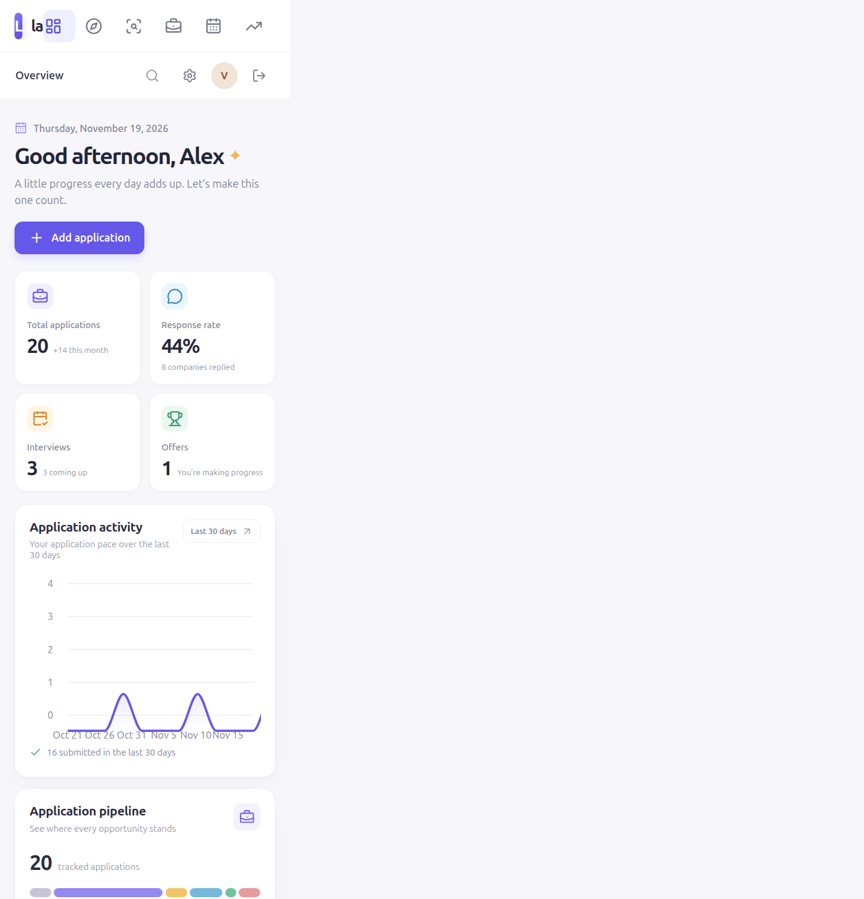
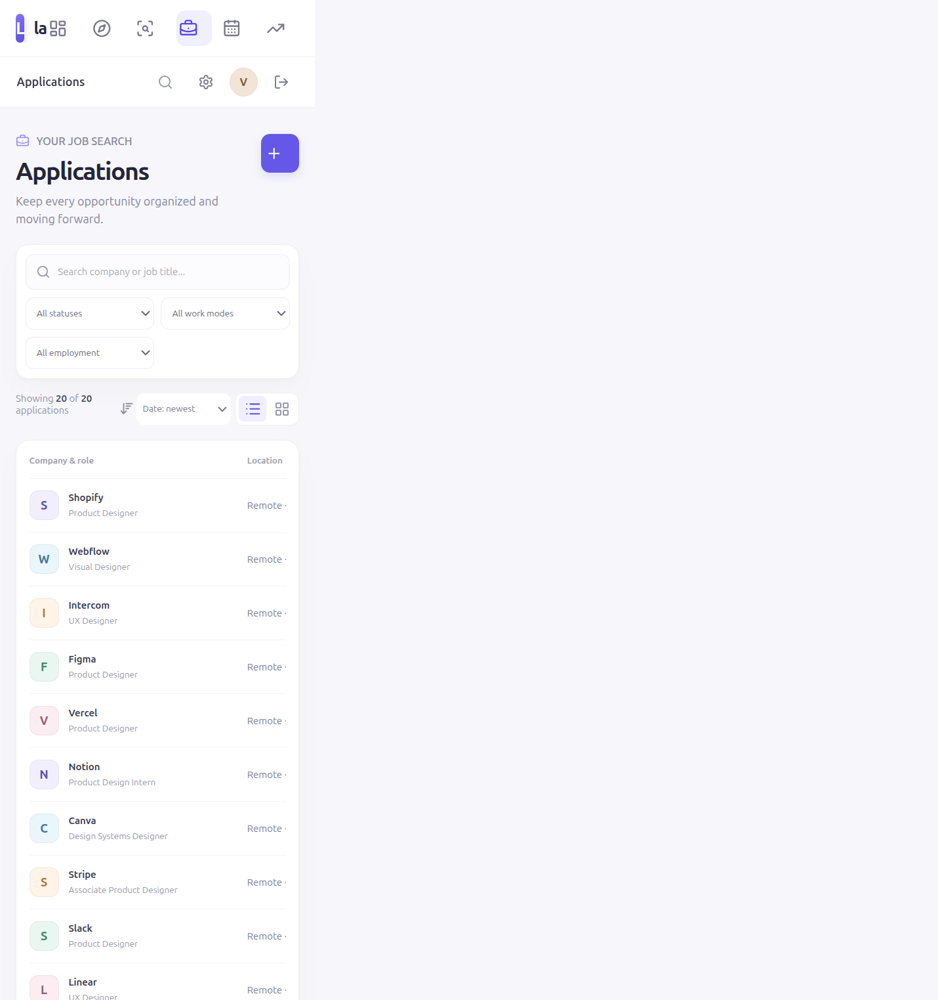
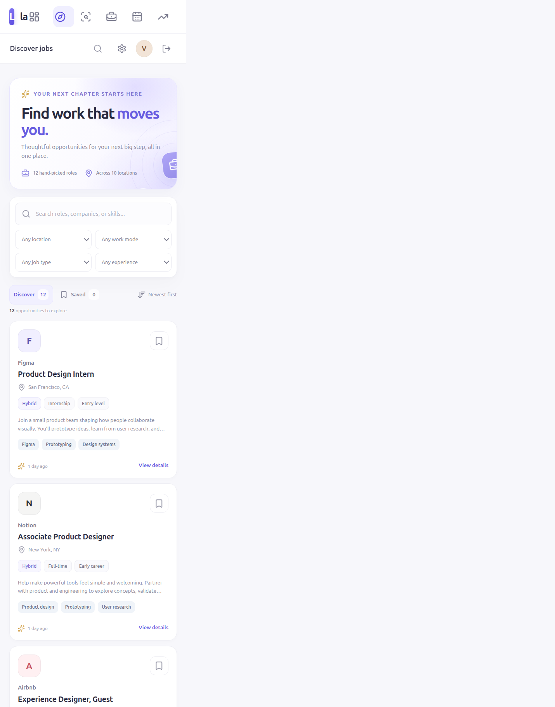
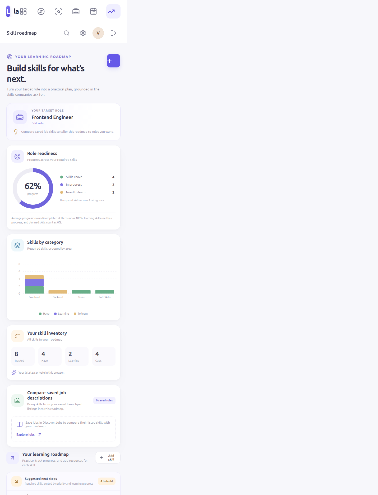
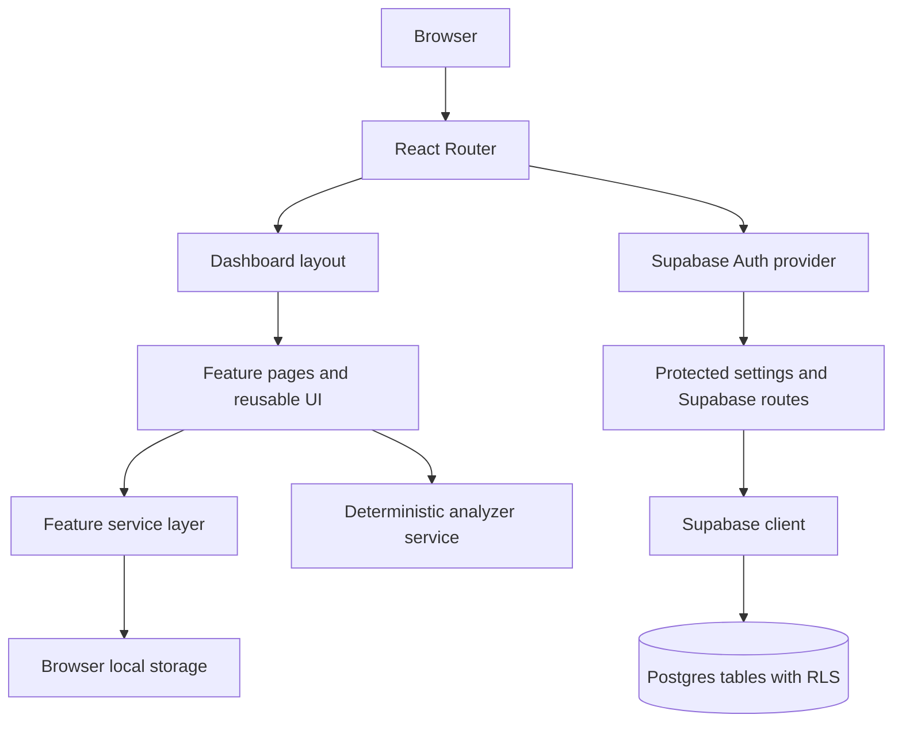

# Launchpad

Launchpad is a job-search workspace for organizing applications, exploring
sample listings, preparing for interviews, and planning skills to learn. This is
a portfolio project built with React and TypeScript.

> **Project status:** The frontend is implemented and builds locally. The main
> job-search features use mock data and browser storage. Supabase authentication,
> profile settings, protected routes, SQL schema, and a separate Supabase
> application tracker are staged integrations; the existing main tracker and
> other feature pages have not all been migrated to Supabase. Launchpad has not
> been deployed to Vercel yet.

## Screenshots

The current UI previews were captured during this session. They use sample/mock
content, not live user data.

| Overview | Application tracker |
| --- | --- |
|  |  |

| Job discovery | Skill roadmap |
| --- | --- |
|  |  |

## Features

| Area | What it contains | Data/backend status |
| --- | --- | --- |
| Overview | Application KPIs, 30-day activity chart, pipeline, upcoming interviews, recent applications, weekly goal | Local application and interview data |
| Application tracker | Create, edit, view, delete, search, filter, sort, table/Kanban views, status updates, activity history | Browser local storage |
| Job discovery | Mock listings, combined filters, newest-first sort, saved jobs, details, add-to-tracker flow | Mock listings and browser storage |
| Match analyzer | Resume/job text comparison, skill overlap, gaps, keywords, and next-step suggestions | Deterministic demo matching; no AI/API call |
| Interview preparation | Checklist, research notes, questions, STAR stories, personal notes, reminders, outcomes | Browser local storage; linked by application id |
| Skill roadmap | Target role, skill status/progress, resources, priorities, and saved-job comparison | Browser local storage |
| Supabase staging | Email/password auth, profile settings, protected routes, connection/CRUD check, separate applications page | Requires a Supabase project and environment variables; main feature routes remain local |

The analyzer is deliberately labeled as a demo. It uses literal keyword matching,
so its score is not a hiring probability and it may miss synonyms, context, or
skills outside its curated vocabulary. Resume text is analyzed in the browser
and is not uploaded or persisted by this feature.

## Tech stack

- React 19, TypeScript 5, Vite 6
- React Router 7 for client-side routing and lazy route loading
- Recharts for dashboard and skill progress visualizations
- Supabase JS for the staged auth/database integration
- Vitest, Testing Library, and jsdom for unit/component tests
- ESLint for linting

## Architecture



Feature code is grouped under `src/features/<feature>/` into pages,
components, services, and types. The local application service owns the
browser-stored application collection used by the dashboard, application
manager, and details page. Saved listings, interview preparation, and the skill
roadmap have their own local storage services; interview records refer to an
application id rather than duplicating its company/role as a source of truth.

The Supabase code is intentionally staged alongside the local product. Its
migrations define profiles, applications, saved jobs, interview preparation,
skills, learning resources, and skill/job-source relationships with
owner-specific Row Level Security policies. The protected Supabase application
route is separate from `/applications`; it is not evidence that every
application feature has already been migrated.

## Local setup

### Requirements

- Node.js 20 or newer (the project was validated with Node 22)
- npm

### Install and run

```bash
npm ci
cp .env.example .env.local
# Add your own Supabase URL and public publishable/anon key if testing Supabase.
npm run dev
```

Vite prints the local URL (normally `http://localhost:5173`). Without Supabase
environment variables, the local/mock feature routes can be explored, while
authentication and protected Supabase routes will not be available.

### Validation commands

```bash
npm test
npm run lint
npm run build
npm run preview
```

The current automated suite has 8 tests across 4 test files. It covers selected
application service behavior, application form validation/submission and focus,
safe behavior when the import ID map cannot be stored, and skill dialog keyboard
behavior. It is not full end-to-end coverage of every route or backend flow.

## Supabase setup

1. Create a Supabase project and open **Project Settings → API**.
2. Copy the project URL and the **publishable** key (or legacy public `anon`
   key). Do not use a secret or `service_role` key in this frontend.
3. Set `VITE_SUPABASE_URL` and `VITE_SUPABASE_PUBLISHABLE_KEY` in `.env.local`.
   The older `VITE_SUPABASE_ANON_KEY` name is also supported.
4. Run the SQL migrations in order in the Supabase SQL Editor:
   - `supabase/migrations/202611190001_launchpad_schema.sql`
   - `supabase/migrations/202611190002_grant_authenticated_table_access.sql`
5. In **Authentication → URL Configuration**, set the Site URL to the
   deployment origin. Add the exact production callback
   `https://YOUR-DOMAIN/auth` to Redirect URLs. Add local and preview origins
   only when you actively use them; keep the allowlist as narrow as practical.
6. Configure email delivery and confirmation behavior for your project, then
   test signup, confirmation, sign-in, password reset, and sign-out using your
   own test account.
7. Verify RLS with two separate test users. Confirm each user can only read and
   mutate their own rows. Do not use production personal data for this test.

The signup flow redirects to `/auth`; password recovery redirects to
`/auth?mode=update-password`. The migration enables RLS and supplies
owner-scoped policies, but production security should still be verified against
the actual Supabase project before inviting users.

## Vercel deployment

`vercel.json` is configured to serve the Vite SPA entry point for client-side
routes, so refreshing a route such as `/applications` does not rely on a
development server fallback.

1. The source repository is
   [vaishnavi-1019/Launchpad](https://github.com/vaishnavi-1019/Launchpad).
   Push the latest `main` branch after local changes are ready.
2. In Vercel, select **Add New → Project**, import the GitHub repository, and
   keep the project root as the root directory.
3. Use the Vite defaults, or confirm:
   - Build command: `npm run build`
   - Output directory: `dist`
   - Install command: `npm install` (Vercel may use the lockfile automatically)
4. In **Project Settings → Environment Variables**, add:
   - `VITE_SUPABASE_URL`
   - `VITE_SUPABASE_PUBLISHABLE_KEY` (or `VITE_SUPABASE_ANON_KEY`)
5. Add variables to the intended Vercel environments (Production, Preview,
   Development), then deploy. Vite embeds `VITE_*` values into client assets:
   only public values belong here. Never add Supabase secret/service-role keys.
6. After Vercel assigns a URL, update the Supabase Site URL and Redirect URLs
   to use that exact HTTPS origin, then redeploy if environment variables
   changed.
7. Test direct navigation and refresh on `/`, `/applications`,
   `/job-discovery`, `/match-analyzer`, `/interview-prep`, `/skill-gap`, `/auth`,
   and the protected Supabase routes. Confirm the production browser console and
   network requests show no configuration or runtime errors.

**Deployment has not been performed.** There is no Vercel project or production
URL configured for this project yet. Do not present the project as deployed
until the Vercel build and production checks above have succeeded.

## Production and demo-account guidance

- Do not publish a shared demo email/password. A shared account can expose
  account data and makes it difficult to demonstrate user isolation safely.
- The screenshots and local product routes use sample data. A live Supabase
  deployment requires a separately configured project and verified policies.
- If offering an interactive public demo, use an isolated demo Supabase project
  with resettable, non-personal seed data, strict quotas, and verified RLS. Do
  not point a public demo account at a personal or production database.
- Keep `.env.local` out of Git. `.env.example` contains placeholders only.

## Verification notes

On the current workspace, `npm test` passed (8 tests), `npm run lint` passed,
`npm run build` passed, and `npm audit` reported zero known vulnerabilities at
the time of this check. Browser checks in the quality pass covered layouts at
320, 390, 768, and 1200 CSS pixels across six local routes, the applications
search focus shortcut/link, keyboard scrolling of the applications table, and
keyboard behavior for dialogs. This does not substitute for production
Supabase, email-delivery, cross-account RLS, or full end-to-end testing.

## Portfolio and interview notes

See [`docs/portfolio-kit.md`](./docs/portfolio-kit.md) for a concise interview
pitch, portfolio description, an honest AI-use statement, and project-based
technical interview questions.
